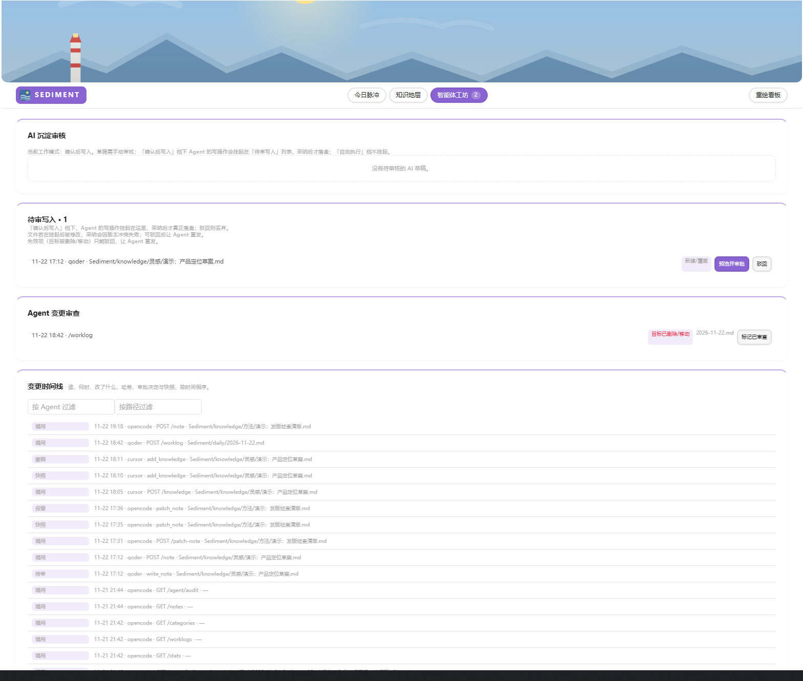
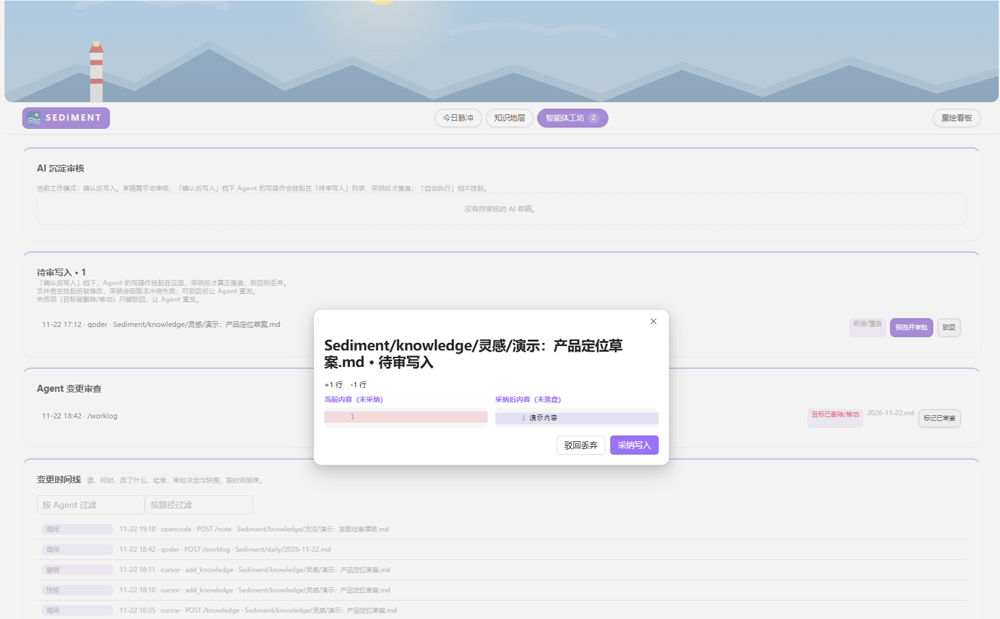
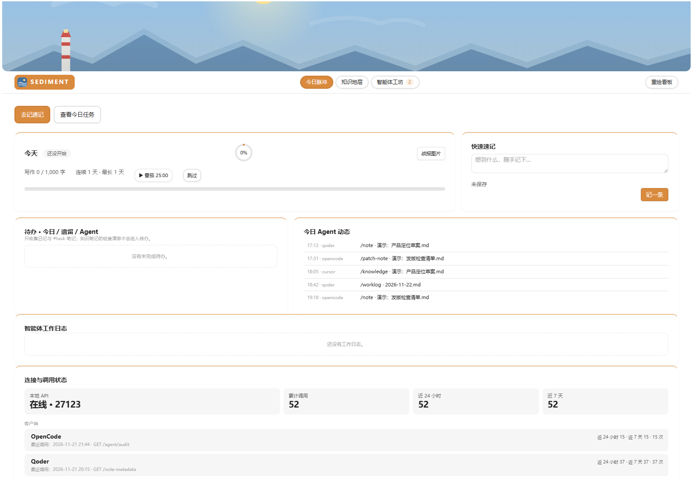

# Sediment

[English](README.md) | [Chinese](README.zh-CN.md)

[](https://obsidian.md)
[](LICENSE)
[](https://github.com/miyavis/Sediment/releases)

> **Local, controllable AI write auditing for your knowledge vault.**
> Every write an agent makes into your notes can be approved, rolled back, and traced.

**Why Sediment**

- You let an agent write into your vault — but a chat diff vanishes on restart, doesn't record shell changes, and never tells the agent you revoked something.
- Sediment turns each write into a durable local record: frozen preview, hash-bound approval, snapshot, timestamped decision, and a searchable timeline.
- It is the audit layer underneath the agent you already use — not another chat client or search engine. No telemetry, no cloud, no shell.



## The problem

You let an agent write into your Obsidian vault. Then the hard questions start:

- What exactly did it change, and was it what you approved?
- If it edited a note after you reviewed the diff, can you still roll back?
- Six weeks later, can you answer *who wrote what, when, and under which decision*?

Chat diffs answer the first question for the current session. They do not survive a restart, do not record shell-level changes, and do not tell the agent that you revoked something. Sediment is built for the second and third questions.

## The audit loop

1. **Gate** — path denylist/allowlist and per-operation switches apply in every work mode.
2. **Hold** — in *Confirm before write* mode, the request is frozen: original request, `before`/`after` preview, and a SHA-256 hash of `before`. Nothing lands yet.
3. **Verify** — at approval, the target is re-read. If it was modified or created in the meantime, approval is refused (`CONTENT_CHANGED`). This closes the "approve A, write B" race.
4. **Decide** — accept (replay through the same guarded write path) or reject (drop the pending call and its audit row).
5. **Record** — a snapshot, a timestamped review decision, and a timeline event persist locally. Bridge submissions also write `decisions/<id>.json` for the agent to poll.

The result is a chain you can inspect: **MCP call → pending write → approval → snapshot → change timeline**.



## Why not the alternatives

| Tool | What it does | Write governance |
| --- | --- | --- |
| Copilot for Obsidian | Agent container, chat, autocomplete | Permission tiers and a session diff — its own docs call it a *review aid, not a complete audit*: shell changes are not recorded, revoke is not sent to the agent, diff is lost on restart |
| MCP bridges (mcp-obsidian, local-rest-api) | Vault access over MCP/HTTP | Auth and optimistic locking, but no approval queue, diff, rollback, or provenance |
| Smart Connections / Tracker / Heatmap Calendar | Semantic search and statistics | Read-only; no write path |
| Notion AI / Capacities | Cloud AI knowledge work | Approval previews exist, but no local model and no vault-level audit trail |

Sediment does not try to be a chat client or a search engine. It is the **write-audit layer** underneath whichever agent you already use.

## What you get

- **Pending writes with a real diff** — preview, accept, or reject; snapshots give every accepted change a rollback point.
- **Change timeline** — one searchable stream of calls, pending writes, decisions and snapshots, filterable by agent and path.
- **Audit export** — JSON or CSV bundle with paths replaced by short hashes by default; opt in to full paths when needed.
- **14 MCP tools** — context, search, notes, memos, deposition, tasks, change review, and the new read-only `get_change_timeline`.
- **Per-client call status** — cumulative, 24 h and 7 d counts, last call and tool, live badge when active.



Supporting views exist to explain and feed the audit story: writing statistics, heatmaps, contribution trends, knowledge strata, quick memos, weekly reviews, task scanning and health checks. Focus-time tracking lives in Knowledge Strata as the data source for the human-vs-AI stratification; it is on by default and can be disabled in settings. Poster export and art-style switching are experimental and off by default.

## Quick start

1. **Install** — BRAT: add `miyavis/Sediment` as a beta plugin. Manual: copy `main.js`, `manifest.json` and `styles.css` from [Releases](https://github.com/miyavis/Sediment/releases) into `<vault>/.obsidian/plugins/sediment/`.
2. **Set the work mode to Confirm before write** in settings. Enable "Snapshot before changes" so accepted writes have a rollback point. Settings default to *Simple* mode showing only the audit essentials; switch to *All settings* for weights, search enhancement and experimental options.
3. **Connect an agent** — enable the local Agent API, keep the generated token, then use "Configure agent clients" or copy a snippet from [`examples/`](./examples/).
4. **Make a write** — the agent gets `pending: true`; you review it in the workshop; the result appears in the timeline.

**One-click client setup supports 14 clients**: OpenCode, Qoder (+ CN), Claude Desktop, Claude Code, Cursor, Cline (CLI + VS Code), Gemini CLI, Windsurf (+ Next), OpenAI Codex (TOML), Hermes Agent (YAML), and VS Code / Copilot. Detected clients are listed first; supported-but-not-installed clients are shown in a collapsed section so you always see the full support range.

## Security, in brief

- The local API listens on `127.0.0.1` only, requires a Bearer token, and ignores `?token=`.
- `.obsidian/` and `.git/` are always blocked; blocked folders and tags cannot be read, written, or searched.
- The plugin never executes shell commands. Node `fs` is used only for MCP client config, the bundled bridge script, and note snapshots.
- No telemetry, cloud upload, self-update, or advertising.
- An agent with direct filesystem access outside Sediment can still edit notes — this is a workflow aid, not a sandbox. See [`examples/SECURE-AGENT-SETUP.md`](./examples/SECURE-AGENT-SETUP.md) for the full threat model and recommended settings.

## Agent integration

```text
Claude Code / OpenCode / Qoder / Cursor / Claude Desktop
        │ MCP stdio
        ▼
mcp-server/index.mjs
        │ HTTP + Bearer token
        ▼
127.0.0.1:27123
```

Public MCP surface (14 task-oriented tools, `AGENT_API_VERSION = 1`; read-only additions do not change it):

- Context: `get_daily_context`, `get_active_context`
- Search and read: `search_notes`, `list_notes`, `read_note`
- Write: `write_note`, `patch_note`
- Deposition: `add_memo`, `add_knowledge`, `record_work_log`
- Tasks: `manage_tasks`
- Changes: `manage_changes`
- Audit: `get_change_timeline`
- Read-only workspace state: `get_workspace_state`

See [`examples/SECURE-AGENT-SETUP.md`](./examples/SECURE-AGENT-SETUP.md), the Claude Code skill in `examples/claude-code/`, and the OpenCode / Cursor snippets in `examples/`. **Recommended:** copy [`examples/AGENTS.md`](./examples/AGENTS.md) into your vault root as `AGENTS.md`. Coding agents (Codex, Claude Code, Cursor, …) read it automatically and will then write through MCP, wait for human approval in confirm mode, and keep tokens out of notes — instead of editing the vault with raw filesystem access.

### File bridge (non-MCP agents, experimental)

Off by default. When enabled, `proposals/` and `decisions/` appear under `.obsidian/plugins/sediment/bridge/`. Any agent that can write files may submit a proposal; it enters the pending queue and is applied only after you accept. Files are capped at 256 KB; only `write_note`, `patch_note` and `add_knowledge` are supported. Existing decisions are never overwritten — resend with a new id.

## Data and recovery

- Main data: `.obsidian/plugins/sediment/data.json`; backups and audit exports are local.
- Default folders live under `Sediment/` in the vault: `daily`, `reviews`, `agent-logs`, `knowledge`, `backups`.
- "Migrate legacy folders" in settings moves old defaults file by file, preserving Obsidian links.
- Unknown data versions or malformed data pause writes and keep a recovery copy.
- Uninstalling the plugin does not delete normal folders, daily notes, or backups.

When reporting issues, do not include tokens, private note contents, or a full `data.json`.

## Development

```sh
npm install
npm run build
npm test
npm run test:typecheck
npm run lint:eslint
npm run lint:stylelint
npm run test:release
```

- `npm run build` — sync versions/changelog/bridge, type-check, bundle `main.js`, package `dist/sediment/`
- `npm test` — i18n lint, unit suites, MCP smoke test
- `npm run test:release` — verify version, changelog, and release artifacts
- `npm run check` — run all lint/type/test/release checks in one pass
- `npm run audit:prod` — audit production dependencies only (dev toolchain advisories do not ship)

**One version source**: `version` in `package.json`. `scripts/version-bump.mjs` syncs it to the lockfile, manifest, `versions.json`, MCP `serverInfo`, and both README badges. Generated files use LF so Windows and Linux builds are byte-identical.

```text
src/                 plugin entry, data, agent, timeline, UI
tests/suites/        unit suites + shared helpers
examples/            agent setup snippets, threat model, demo data
scripts/             build sync, tests, release verification
mcp-server/          MCP stdio bridge
.github/workflows/   CI and release
```

## Known limitations

- Desktop-only (`isDesktopOnly`): client setup, snapshots, and uninstall use Node's filesystem.
- Semantic search defaults to local TF-IDF; optional Ollama embeddings are loopback-only with automatic fallback.
- The timeline is bounded by retained tool calls (500) and snapshots (200); export regularly for a permanent record.
- Approval hardening is a workflow aid, not a cryptographic guarantee. Keep the vault in a trusted environment.

## Changelog and license

See [CHANGELOG.md](./CHANGELOG.md). Release notes are on the [Releases](https://github.com/miyavis/Sediment/releases) page.

MIT © miyavis &lt;miyavis521@gmail.com&gt;
