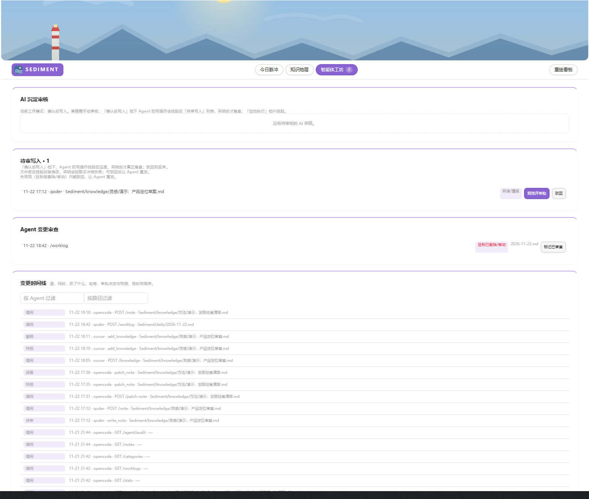
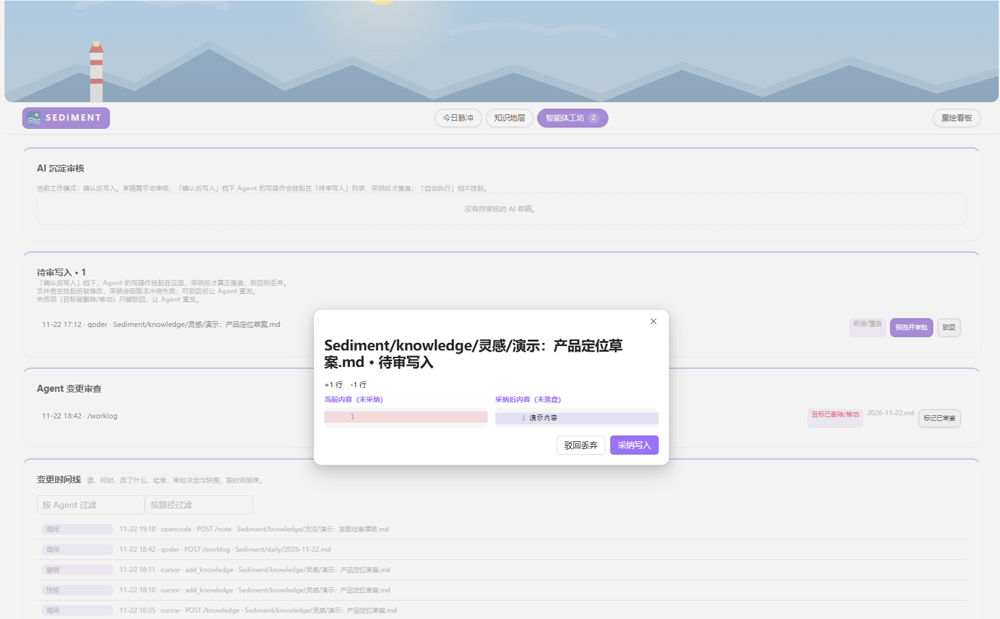

# Sediment

[English](README.md) | 简体中文

> **本地可控的 AI 写入审计层 —— 让 Agent 写进你知识库的每一笔都可审批、可回滚、可追溯。**

[](https://obsidian.md)
[](LICENSE)
[](https://github.com/miyavis/Sediment/releases)

Sediment 是一个本地优先的 Obsidian 插件 + MCP 服务，面向「让 AI Agent 写入知识库、但要有证据而非凭感觉」的人。Agent 的写入会变成待审提案：冻结预览、按哈希绑定你的审批；采纳后进入持久、可检索的变更时间线，附带快照与审批决定。不上传任何内容，也不执行任何 shell 命令。






## 为什么不是又一个看板？

| 工具 | 做什么 | 写入治理 |
| --- | --- | --- |
| Copilot for Obsidian | Agent 容器、聊天、补全 | 有权限档和会话内 diff，但官方文档自承只是「review aid，不是完整审计」：shell 改动不记录、驳回不回告 Agent、重启丢 diff |
| MCP 桥（mcp-obsidian / local-rest-api） | 通过 MCP/HTTP 访问库 | 有鉴权与乐观锁，但没有审批队列、diff、回滚或来源登记 |
| Smart Connections / Tracker / 热力图日历 | 语义检索与统计 | 只读，没有写入链路 |
| Notion AI / Capacities | 云端 AI 知识管理 | 有审批预览，但没有本地模型，也没有库级审计链 |

Sediment 补的就是这个缺口：**一套持久、本地、可审计的写入工作流**。Agent 往库里写了什么，你事后能回答「谁、什么时候、改了什么、依据哪次审批、上一版是什么」。

## 核心：写入审计闭环

1. **门禁** —— 目录黑名单/白名单、按操作开关、四档工作模式（只读 / 草稿 / 确认后写入 / 自动执行）。
2. **挂起** —— confirm 档冻结请求：原请求、`before`/`after` 预览、`before` 的 SHA-256 哈希；此时一切未落盘。
3. **复验** —— 采纳时重读目标；若期间被修改或抢先创建，拒绝采纳（`CONTENT_CHANGED`），堵住「批准 A、落盘 B」的竞态。
4. **决定** —— 采纳（走同一套受门禁保护的落盘函数）或驳回（清掉挂起调用及其审计行）。
5. **留痕** —— 快照、带时间戳的审批决定、时间线事件写入 `data.json`；文件桥提案还会写 `decisions/<id>.json` 供 Agent 轮询。

于是形成一条链：**MCP 调用 → 待审写入 → 审批 → 快照 → 变更时间线**，全部在本地。

## 变更时间线

工坊里提供可检索的 Agent 活动事件流：客户端、时间、工具、目标路径、内容哈希、审批决定、快照 id。工具调用、待审写入、审批决定、文件桥决策被合并成一个视图。

- 按 Agent / 操作类型 / 时间过滤
- 导出审计包（JSON / CSV），默认脱敏
- Agent 可通过 `get_change_timeline` 工具读取

## 网络与文件访问

- 本地 Agent API 默认关闭，只监听 `127.0.0.1`，请求需设置页生成的令牌。
- 可选语义检索指向本机 Ollama（默认回环地址），不可用时回退 TF-IDF。
- 「一键配置智能体客户端」只读写库外用户主目录 / `%APPDATA%` 下的 MCP 配置文件（如 `~/.claude.json`、`~/.cursor/mcp.json`、`~/.config/opencode/opencode.jsonc`），只增删 Sediment 条目。
- Node `fs` 只用于上述 MCP 配置、插件自有的 `mcp-server/index.mjs` 和 `.obsidian/plugins/sediment/backups/` 快照。**插件不执行 shell 命令。**
- 看板统计只枚举库内笔记路径与元数据，全部本地处理，不上传笔记内容或路径清单。
- Agent 调用统计聚合后存于本地 `data.json`，不上传。
- 无遥测、无云端上传、无自更新、无广告。

威胁模型与建议设置见 `examples/SECURE-AGENT-SETUP.md`。

## 配套视图

这些是为了喂养和解释审计工作流而存在，不与单一用途插件正面竞争：

- 写作统计、热力图、贡献趋势、知识地层 —— 本地、可解释的时间去向视图
- 快速速记：日记双写、可定位回原笔记行号
- 周复盘生成、待办扫描、笔记健康度
- 番茄钟与月报海报（实验性，默认关闭）

贡献分（权重与单日封顶可配置）：

```text
score = 新建笔记 × 2 + 编辑会话 + 完成任务
      + floor(新增词数 / 100)
      + floor(专注分钟 / 25)
```

它是辅助指标，不是知识质量的度量。

## 安装

### BRAT

1. 安装并启用 [BRAT](https://github.com/TfTHacker/obsidian42-brat)。
2. 选择 **Add Beta plugin**。
3. 输入 `miyavis/Sediment`。
4. 在第三方插件列表中启用 Sediment。

### 手动安装

1. 从 [Releases](https://github.com/miyavis/Sediment/releases) 下载 `main.js`、`manifest.json`、`styles.css`。
2. 放入 `<vault>/.obsidian/plugins/sediment/`。
3. 在设置 → 第三方插件中启用 Sediment。

Release 只提供 Obsidian 安装所需的三个文件，并附 GitHub build provenance attestation。配置 Agent API 时插件会把桥接脚本写入插件目录的 `mcp-server/`。

`.obsidian` 是 vault 根目录下的隐藏文件夹，不在插件仓库里。Windows 可在地址栏粘贴 `<vault 路径>\.obsidian\plugins\sediment`；macOS 用 `Cmd + Shift + .`；Linux 用 `Ctrl + H`。

## Agent 接入

```text
Claude Code / OpenCode / Qoder / Cursor / Claude Desktop
        │ MCP stdio
        ▼
mcp-server/index.mjs
        │ HTTP + Bearer 令牌
        ▼
127.0.0.1:27123
```

步骤：

1. 设置中启用本地 Agent API。
2. 保留生成的访问令牌。
3. 使用「一键配置智能体客户端」，或复制 [`examples/`](./examples/) 中的片段。
4. 重启客户端。
5. 把工作模式设为 **确认后写入**，即可获得完整审计闭环。

公开的 MCP 接口为 **14 个任务型工具**（只读新增不改变 `AGENT_API_VERSION = 1`）：

- 上下文：`get_daily_context`、`get_active_context`
- 检索与读取：`search_notes`、`list_notes`、`read_note`
- 写入：`write_note`、`patch_note`
- 沉淀：`add_memo`、`add_knowledge`、`record_work_log`
- 任务：`manage_tasks`
- 变更：`manage_changes`
- 审计：`get_change_timeline`
- 只读工作区状态：`get_workspace_state`

参见 [`examples/SECURE-AGENT-SETUP.md`](./examples/SECURE-AGENT-SETUP.md) 与各客户端片段。

### 文件桥（非 MCP Agent，实验性）

默认关闭。启用后插件会在 `.obsidian/plugins/sediment/bridge/` 下创建 `proposals/` 与 `decisions/`。任何能写文件的 Agent 都可提交提案；提案只进入待审队列，必须你采纳后才落盘。单文件上限 256 KB，仅支持 `write_note`、`patch_note`、`add_knowledge`。

决定后写入 `decisions/<id>.json` 供 Agent 轮询：

```json
{
  "version": 1,
  "id": "demo-1",
  "pendingId": "bridge-demo-1",
  "decision": "approved",
  "reason": "user_approved",
  "time": "2026-11-21T10:00:00.000Z"
}
```

已有决定不会被覆盖，重新提交请换新 id。

安全边界：

- 本地服务只监听 `127.0.0.1`，无令牌请求直接拒绝
- `.obsidian/` 与 `.git/` 始终拦截
- 黑名单目录/标签不可读、不可写、不可搜索
- 高风险操作可配合快照、diff 与恢复点审查
- 不执行 shell，不上传云端

## 数据与恢复

- 主数据：`.obsidian/plugins/sediment/data.json`
- 默认目录位于库内 `Sediment/` 下：`daily`、`reviews`、`agent-logs`、`knowledge`、`backups`
- 设置里的「旧版目录迁移」会逐文件移动并保留 Obsidian 链接
- 未知数据版本或结构损坏：暂停写入并保留恢复副本
- 备份与审计导出均在本地；卸载插件不会删除普通目录、日记或备份

反馈问题时请不要附上令牌、私密笔记内容或完整 `data.json`。

## 开发

```sh
npm install
npm run dev
npm run build
npm test
npm run test:typecheck
npm run lint:eslint
npm run lint:stylelint
npm run test:release
```

- `npm run build`：同步版本 / CHANGELOG / MCP bridge、类型检查、打包 `main.js` 与 `dist/sediment/`
- `npm test`：i18n lint + 单测 + MCP 冒烟
- `npm run test:release`：校验版本、CHANGELOG 与发布产物

**版本唯一源** 是 `package.json`；`scripts/version-bump.mjs` 同步到 lockfile、manifest、versions、MCP `serverInfo` 与两份 README 徽章。生成文件统一 LF，保证 Windows / Linux 构建可复现。

```text
src/                 插件入口、数据、Agent、时间线、UI
tests/               单测分套（tests/suites/）+ 共享 helpers
scripts/             构建同步、测试与发布校验
examples/            Agent 客户端配置示例与威胁模型
mcp-server/          MCP stdio 桥接
.github/workflows/   CI 与发布
```

## 已知限制

- 桌面专用：客户端配置、快照与卸载依赖 Node 文件系统（已设 `isDesktopOnly`）
- 语义检索默认本地 TF-IDF；可选本机 Ollama embedding 仅回环，失败自动回退
- 时间线受保留上限约束（调用流水 500 条、快照索引 200 条）；需要长期留存请定期导出
- 审批是工作流辅助，不是密码学保证：有库外文件系统权限的 Agent 仍可直接改笔记。请把库放在可信环境，并阅读 `examples/SECURE-AGENT-SETUP.md` 的威胁模型

## 更新记录与许可

见 [CHANGELOG.md](./CHANGELOG.md)。发布说明与兼容性见 [Releases](https://github.com/miyavis/Sediment/releases)。

MIT © miyavis &lt;miyavis521@gmail.com&gt;
