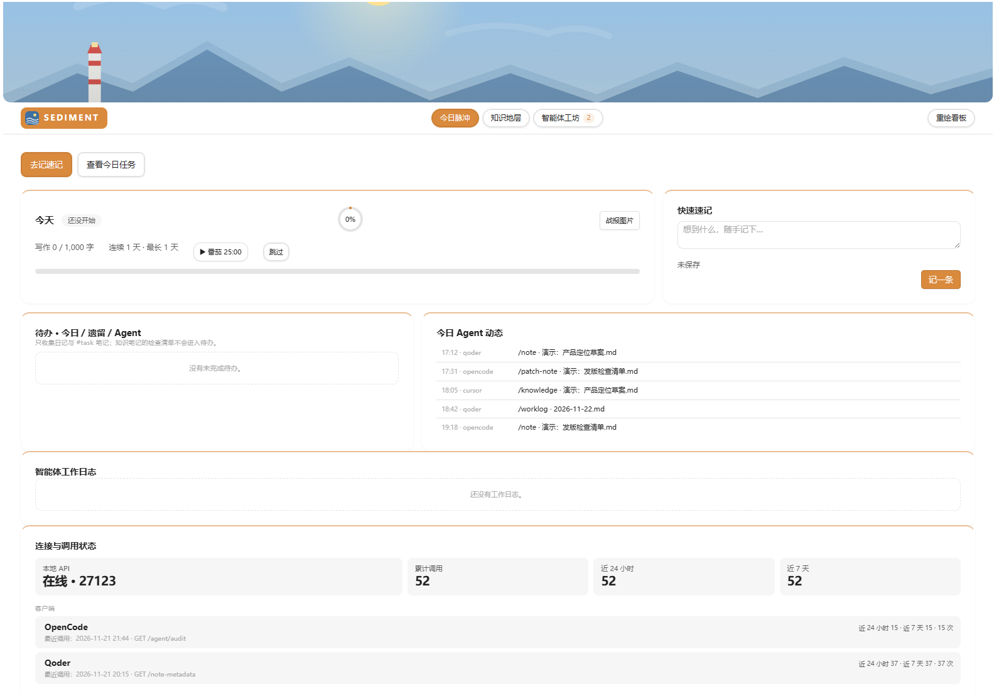

# Sediment

[English](README.md) | 简体中文

[](https://obsidian.md)
[](LICENSE)
[](https://github.com/miyavis/Sediment/releases)

> **本地可控的 AI 写入审计层 —— 让 Agent 写进你知识库的每一笔都可审批、可回滚、可追溯。**

**为什么是 Sediment**

- 你让 Agent 往库里写东西，但聊天式 diff 重启即丢、不记录 shell 改动、驳回也不会回告 Agent。
- Sediment 把每次写入变成持久的本地记录：冻结预览、哈希绑定的审批、快照、带时间戳的决定，以及可检索的时间线。
- 它是你现有 Agent 之下的审计层，不是又一个聊天客户端或搜索引擎。无遥测、不上云、不执行 shell。


## 它解决什么问题

你让 Agent 往 Obsidian 库里写东西，然后难题才开始：

- 它到底改了什么？和你批准的是不是一回事？
- 如果它在你审完 diff 之后又改了同一篇笔记，还能回滚吗？
- 六周之后，你能回答「谁、什么时候、依据哪次决定、写了什么」吗？

聊天式 diff 只能回答当前会话的第一个问题。它重启即丢、不记录 shell 级改动、驳回也不会回告 Agent。Sediment 是为第二、第三个问题而造的。

## 审计闭环

1. **门禁** —— 目录黑名单/白名单与按操作开关，在所有工作模式下都是硬限制。
2. **挂起** —— 「确认后写入」档冻结请求：原请求、`before`/`after` 预览、`before` 的 SHA-256 哈希；此时未落盘。
3. **复验** —— 采纳时重读目标；若期间被修改或抢先创建，拒绝采纳（`CONTENT_CHANGED`），堵住「批准 A、落盘 B」的竞态。
4. **决定** —— 采纳（走同一套受门禁保护的落盘函数）或驳回（清掉挂起调用及其审计行）。
5. **留痕** —— 快照、带时间戳的审批决定、时间线事件全部存于本地；文件桥提案还会写 `decisions/<id>.json` 供 Agent 轮询。

于是形成一条可检查的链：**MCP 调用 → 待审写入 → 审批 → 快照 → 变更时间线**。


## 为什么不是这些替代品

| 工具 | 做什么 | 写入治理 |
| --- | --- | --- |
| Copilot for Obsidian | Agent 容器、聊天、补全 | 有权限档与会话内 diff，但官方自承只是「review aid，不是完整审计」：shell 改动不记录、驳回不回告 Agent、重启丢 diff |
| MCP 桥（mcp-obsidian / local-rest-api） | 通过 MCP/HTTP 访问库 | 有鉴权与乐观锁，但没有审批队列、diff、回滚或来源登记 |
| Smart Connections / Tracker / 热力图日历 | 语义检索与统计 | 只读，没有写入链路 |
| Notion AI / Capacities | 云端 AI 知识管理 | 有审批预览，但没有本地模型，也没有库级审计链 |

Sediment 不打算做聊天客户端或搜索引擎。它是你现有 Agent 之下的**写入审计层**。

## 你会得到什么

- **带真实 diff 的待审写入** —— 预览、采纳或驳回；快照让每次采纳都有回滚点
- **变更时间线** —— 调用、挂起、决定、快照合并成一条可检索事件流，按 Agent 与路径过滤
- **审计包导出** —— JSON / CSV，路径默认以短哈希代替，需要时再显式开启完整路径
- **14 个 MCP 工具** —— 上下文、检索、笔记、速记、沉淀、任务、变更审查，以及新增的只读 `get_change_timeline`
- **按客户端调用状态** —— 累计、近 24 小时、近 7 天、最近调用与工具；5 分钟内有调用显示活跃徽章



配套视图是为了解释和喂养审计链路而存在：写作统计、热力图、贡献趋势、知识地层、速记、周复盘、待办与健康度。专注时长采集放在「知识地层」页，作为「人写 vs AI 写」分层的人类时间数据源，默认开启、可在设置关闭。海报导出与多画风是实验性功能，默认关闭。

## 快速开始

1. **安装** —— BRAT：把 `miyavis/Sediment` 加为 beta 插件。手动：从 [Releases](https://github.com/miyavis/Sediment/releases) 下载 `main.js`、`manifest.json`、`styles.css` 放入 `<vault>/.obsidian/plugins/sediment/`。
2. **工作模式设为「确认后写入」**，并打开「修改前快照」，让采纳后的每次写入都有回滚点。设置页默认是「简洁」模式，只显示审计核心项；切到「全部设置」可查看权重、检索增强与实验性选项。
3. **接入 Agent** —— 启用本地 Agent API，保留生成的令牌，然后用「一键配置智能体客户端」或复制 [`examples/`](./examples/) 中的片段。
4. **发起一次写入** —— Agent 得到 `pending: true`；你在工坊审查；结果出现在时间线。

**一键配置支持 14 种客户端**：OpenCode、Qoder（含 CN）、Claude Desktop、Claude Code、Cursor、Cline（CLI + VS Code）、Gemini CLI、Windsurf（含 Next）、OpenAI Codex（TOML）、Hermes Agent（YAML）、VS Code / Copilot。已检测到的优先显示；支持但未安装的客户端收在折叠区，始终能看到完整支持范围。

## 安全，简要版

- 本地 API 只监听 `127.0.0.1`，需 Bearer 令牌，`?token=` 无效
- `.obsidian/` 与 `.git/` 始终拦截；黑名单目录/标签不可读、不可写、不可搜索
- 插件不执行 shell；Node `fs` 只用于 MCP 客户端配置、自带桥接脚本和笔记快照
- 无遥测、云端上传、自更新、广告
- 有库外文件系统权限的 Agent 仍可直接改笔记——这是工作流辅助，不是沙箱。完整威胁模型与建议设置见 [`examples/SECURE-AGENT-SETUP.md`](./examples/SECURE-AGENT-SETUP.md)

## Agent 接入

```text
Claude Code / OpenCode / Qoder / Cursor / Claude Desktop
        │ MCP stdio
        ▼
mcp-server/index.mjs
        │ HTTP + Bearer 令牌
        ▼
127.0.0.1:27123
```

公开 MCP 接口共 14 个任务型工具（`AGENT_API_VERSION = 1`；只读新增不改变它）：

- 上下文：`get_daily_context`、`get_active_context`
- 检索与读取：`search_notes`、`list_notes`、`read_note`
- 写入：`write_note`、`patch_note`
- 沉淀：`add_memo`、`add_knowledge`、`record_work_log`
- 任务：`manage_tasks`
- 变更：`manage_changes`
- 审计：`get_change_timeline`
- 只读工作区状态：`get_workspace_state`

参见 [`examples/SECURE-AGENT-SETUP.md`](./examples/SECURE-AGENT-SETUP.md)、`examples/claude-code/` 的 skill，以及 `examples/` 下的 OpenCode / Cursor 片段。**建议**：把 [`examples/AGENTS.md`](./examples/AGENTS.md) 复制成库根目录的 `AGENTS.md`。编码 Agent（Codex、Claude Code、Cursor 等）会自动读取，从而一律走 MCP 写入、confirm 档等待人工审批、不把令牌写进笔记，而不是用文件系统直接改库。

### 文件桥（非 MCP Agent，实验性）

默认关闭。启用后 `.obsidian/plugins/sediment/bridge/` 下出现 `proposals/` 与 `decisions/`。任何能写文件的 Agent 都可提交提案；提案只进入待审队列，必须你采纳后落盘。单文件上限 256 KB，仅支持 `write_note`、`patch_note`、`add_knowledge`。已有决定不会被覆盖，重发请换新 id。

## 数据与恢复

- 主数据：`.obsidian/plugins/sediment/data.json`；备份与审计导出均为本地
- 默认目录位于库内 `Sediment/` 下：`daily`、`reviews`、`agent-logs`、`knowledge`、`backups`
- 「旧版目录迁移」会逐文件移动并保留 Obsidian 链接
- 未知数据版本或结构损坏：暂停写入并保留恢复副本
- 卸载插件不会删除普通目录、日记或备份

反馈问题时请不要附上令牌、私密笔记内容或完整 `data.json`。

## 开发

```sh
npm install
npm run build
npm test
npm run test:typecheck
npm run lint:eslint
npm run lint:stylelint
npm run test:release
```

- `npm run build`：同步版本 / CHANGELOG / 桥接、类型检查、打包 `main.js` 与 `dist/sediment/`
- `npm test`：i18n lint + 单测分套 + MCP 冒烟
- `npm run test:release`：校验版本、CHANGELOG 与发布产物
- `npm run check`：一条命令跑完全部 lint / 类型 / 测试 / 发布校验
- `npm run audit:prod`：只扫生产依赖（开发工具链的漏洞不会进入发布产物）

**版本唯一源** 是 `package.json`；`scripts/version-bump.mjs` 同步到 lockfile、manifest、`versions.json`、MCP `serverInfo` 与两份 README 徽章。生成文件统一 LF，Windows / Linux 构建字节一致。

```text
src/                 插件入口、数据、Agent、时间线、UI
tests/suites/        单测分套 + 共享 helpers
examples/            Agent 配置示例、威胁模型、演示数据
scripts/             构建同步、测试与发布校验
mcp-server/          MCP stdio 桥接
.github/workflows/   CI 与发布
```

## 已知限制

- 桌面专用（`isDesktopOnly`）：客户端配置、快照与卸载依赖 Node 文件系统
- 语义检索默认本地 TF-IDF；可选本机 Ollama embedding 仅回环，失败自动回退
- 时间线受保留上限约束（调用流水 500 条、快照 200 条）；需长期留存请定期导出
- 审批加固是工作流辅助，不是密码学保证；请把库放在可信环境

## 更新记录与许可

见 [CHANGELOG.md](./CHANGELOG.md)。发布说明见 [Releases](https://github.com/miyavis/Sediment/releases)。

MIT © miyavis &lt;miyavis521@gmail.com&gt;
